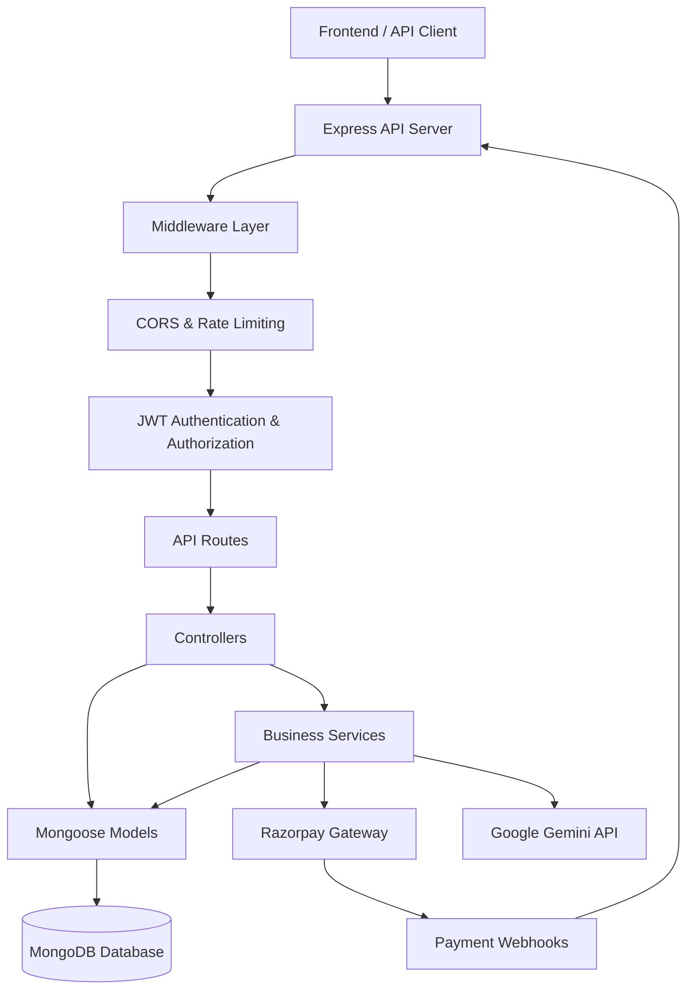

# 🍽️ LUX RESTAURANT BACKEND

**Node.js and Express API for the LUX Restaurant Platform**

[](https://lux-restaurant-backend.onrender.com)
[](https://luxrestaurant.vercel.app/)
[](https://nodejs.org/)
[](https://expressjs.com/)
[](https://www.mongodb.com/)
[](tests/)

**Backend Repository:** [LUX-Restaurant-Backend](https://github.com/Sourav142005/LUX-Restaurant-Backend)  
**Frontend Repository:** [LUX-Restaurant-Frontend](https://github.com/Sourav142005/LUX-Restaurant-Frontend)

---

## 📖 Overview

LUX Restaurant Backend is a RESTful API built using **Node.js, Express 5, MongoDB, and Mongoose**. It powers the customer-facing restaurant application and administrative workflows, including authentication, menu management, reservations, food ordering, online payments, customer reviews, saved regular orders, seasonal specials, and operational reporting.

The backend also integrates **Razorpay** for online payments and refunds and **Google Gemini** for the LUX AI Dining Concierge.

Payment processing includes webhook signature verification, duplicate-event protection, refund tracking, and reconciliation safeguards to improve financial reliability.

## ✨ Core Functional Capabilities

### 1. Authentication & Identity

- Customer registration and login.
- Phone OTP verification.
- Email and phone-based password recovery.
- JWT-based authentication.
- Role-based access control for customers and administrators.
- Rate limiting for sensitive authentication endpoints.

### 2. Menu Management & Discovery

- Complete menu and category management.
- Menu item creation, editing, deletion, and availability management.
- Support for dish information, pricing, and 3D model references.
- **Most Ordered Dishes:** Identifies popular dishes using eligible order quantities over a rolling seven-day period.
- Excludes cancelled, pending, reconciliation-flagged, and other ineligible orders from popularity calculations.
- **Seasonal Specials:** Administrators can mark dishes as seasonal specials and configure optional start and end dates.
- Public seasonal-special listings respect the configured availability period.

### 3. Order Management

- Supports Dine-In, Takeaway, and Delivery orders.
- PayNow and eligible PayAfterDining payment policies.
- Order lifecycle management.
- Order history and individual order retrieval.
- Dedicated order cancellation workflow.
- Table session closing and floor availability synchronization.
- Scheduled order processing.

Order status progression:

`Scheduled → Pending → Preparing → Ready → Delivered`

Orders may also be cancelled through the dedicated cancellation workflow.

### 4. Razorpay Payment & Refund Management

- Razorpay payment order generation.
- Client-side payment verification.
- Raw-body HMAC webhook signature verification.
- Duplicate webhook event detection.
- Full and partial refund support.
- Refund transaction audit records.
- Cumulative refunded amount tracking.
- Safe handling of unpaid order cancellations.
- Reconciliation flags for payment operations requiring administrative attention.

### 5. Table & Reservation Management

- Physical restaurant table inventory.
- Table capacity and status management.
- Table-specific QR integration.
- Reservation availability checking.
- Reservation booking and cancellation.
- Prevention of overlapping reservation bookings.
- Automatic table status synchronization.

### 6. Ratings & Reviews

- Customers can submit ratings from 1 to 5 stars.
- Optional review comments with a maximum length of 500 characters.
- One review per customer per menu item.
- Review editing and deletion.
- Only customers with qualifying delivered orders can review a dish.
- Backend verifies purchase eligibility and review ownership.
- Menu ratings and review counts are recalculated after review changes.

### 7. My Regular Orders

- Customers can create multiple private collections of frequently ordered dishes.
- Create, rename, and delete collections.
- Add dishes to collections.
- Update saved item quantities.
- Remove individual dishes.
- Validate saved collections before reordering.
- Reorder validation checks current menu availability and pricing.

Saved collections do not store fixed dish prices. Current menu data is used during reorder validation. Validation itself does not create an order or initiate payment.

### 8. LUX AI Dining Concierge

- Google Gemini-powered conversational assistant.
- Natural-language dish recommendations.
- Live menu context.
- Availability-aware recommendations.
- Rule-based fallback when the external AI service is unavailable or rate-limited.
- Structured cart suggestions for frontend integration.

---

## 🏛️ System Architecture



## 🛠️ Technology Stack

| Category | Technology |
|---|---|
| Runtime | Node.js |
| Backend Framework | Express 5 |
| Database | MongoDB |
| ODM | Mongoose |
| Authentication | JWT |
| Password Security | bcryptjs |
| Payment Gateway | Razorpay |
| AI Integration | Google Gemini |
| Rate Limiting | express-rate-limit |
| Testing | Node.js Built-in Test Runner |
| Deployment | Render |

---

## 📂 Project Structure

The following is a high-level representation of the backend organization. Confirm individual filenames against the current repository.

```text
backend/
│
├── config/
│   └── db.js
│
├── controllers/
│   ├── adminController.js
│   ├── authController.js
│   ├── categoryController.js
│   ├── menuController.js
│   ├── orderController.js
│   ├── paymentController.js
│   ├── reservationController.js
│   ├── tableController.js
│   ├── userController.js
│   └── webhookController.js
│
├── middleware/
│   ├── admin.js
│   ├── auth.js
│   └── rateLimiter.js
│
├── models/
│   ├── Category.js
│   ├── Menu.js
│   ├── Order.js
│   ├── Payment.js
│   ├── Reservation.js
│   ├── Review.js
│   ├── RegularOrder.js
│   ├── Table.js
│   └── User.js
│
├── routes/
│   ├── adminRoutes.js
│   ├── aiRoutes.js
│   ├── authRoutes.js
│   ├── categoryRoutes.js
│   ├── menuRoutes.js
│   ├── orderRoutes.js
│   ├── paymentRoutes.js
│   ├── reservationRoutes.js
│   ├── reviewRoutes.js
│   ├── regularOrderRoutes.js
│   ├── tableRoutes.js
│   └── userRoutes.js
│
├── services/
│   ├── aiService.js
│   ├── orderCancellationService.js
│   ├── razorpayService.js
│   ├── scheduledOrderService.js
│   └── scheduler.js
│
├── tests/
│
├── package.json
├── server.js
└── README.md
```

---

## 🚀 Getting Started

### Prerequisites

- Node.js 20 or later recommended.
- npm package manager.
- MongoDB local installation or MongoDB Atlas account.
- Razorpay test credentials for payment testing.
- Google AI Studio API key for AI functionality.

### 1. Clone the Repository

```bash
git clone https://github.com/Sourav142005/LUX-Restaurant-Backend.git
```

### 2. Navigate to the Project

```bash
cd LUX-Restaurant-Backend
```

### 3. Install Dependencies

```bash
npm install
```

### 4. Environment Configuration

Create a `.env` file in the backend root directory.

```dotenv
# Server
PORT=5000
NODE_ENV=development

# Database
MONGO_URI=your_mongodb_connection_string

# Authentication
JWT_SECRET=your_long_random_jwt_secret

# CORS
CLIENT_URL=http://localhost:5173,http://localhost:5174,https://luxrestaurant.vercel.app

# Razorpay
RAZORPAY_KEY_ID=your_razorpay_key_id
RAZORPAY_KEY_SECRET=your_razorpay_key_secret
RAZORPAY_WEBHOOK_SECRET=your_razorpay_webhook_secret

# Google Gemini
GEMINI_API_KEY=your_gemini_api_key

# OTP
OTP_DELIVERY=console
```

Replace all placeholder values with your actual configuration.

> **Security:** Never commit `.env` files or expose backend secrets in frontend code. Keep production credentials inside the deployment provider's environment-variable settings.

### 5. Run the Development Server

```bash
npm run dev
```

The backend uses port `5000` by default.

### Available Scripts

| Command | Description |
|---|---|
| `npm run dev` | Starts the development server using nodemon. |
| `npm start` | Starts the production server using Node.js. |
| `npm test` | Executes automated tests using the Node.js test runner. |

---

## 📡 API Reference

All endpoints use the `/api` prefix.

The following tables summarize the documented API routes. Check the corresponding route files for the exact current implementation and access requirements.

### Authentication Routes — `/api/auth`

| Method | Endpoint | Description |
|---|---|---|
| POST | `/api/auth/register` | Register a customer account. |
| POST | `/api/auth/login` | Authenticate a customer. |
| POST | `/api/auth/verify-phone` | Verify phone OTP. |
| POST | `/api/auth/resend-phone-otp` | Resend phone verification OTP. |
| POST | `/api/auth/forgot-password` | Start email password recovery. |
| POST | `/api/auth/forgot-password-phone` | Start phone-based password recovery. |
| POST | `/api/auth/reset-password/:token` | Reset password using email token. |
| POST | `/api/auth/reset-password-phone` | Reset password using phone OTP. |
| GET | `/api/auth/profile` | Retrieve authenticated user profile. |

### Menu & Category Routes

| Method | Endpoint | Description |
|---|---|---|
| GET | `/api/menu` | Retrieve menu items. |
| GET | `/api/menu/:id` | Retrieve a specific menu item. |
| GET | `/api/menu/most-ordered` | Retrieve most-ordered dishes. |
| GET | `/api/menu/seasonal-specials` | Retrieve active seasonal specials. |
| POST | `/api/menu` | Create a menu item. |
| PUT | `/api/menu/:id` | Update menu item details. |
| DELETE | `/api/menu/:id` | Delete a menu item. |
| PUT | `/api/menu/:id/seasonal-special` | Update seasonal-special settings. |
| GET | `/api/category` | Retrieve categories. |
| POST | `/api/category` | Create a category. |
| PUT | `/api/category/:id` | Update a category. |
| DELETE | `/api/category/:id` | Delete a category. |

### Order Management Routes — `/api/order`

| Method | Endpoint | Description |
|---|---|---|
| POST | `/api/order` | Create a new order. |
| GET | `/api/order/my` | Retrieve customer order history. |
| GET | `/api/order/:id` | Retrieve order details. |
| PATCH | `/api/order/:id/cancel` | Cancel an order safely. |
| POST | `/api/order/:orderId/payment` | Generate a Razorpay payment order. |
| POST | `/api/order/:orderId/payment/verify` | Verify payment signature. |
| POST | `/api/order/:id/close-table` | Close a table session. |
| GET | `/api/order` | Retrieve orders for administration. |
| PUT | `/api/order/:id` | Update order status. |
| DELETE | `/api/order/:id` | Delete an order. |
| POST | `/api/order/process-scheduled` | Trigger scheduled-order processing. |

### Payment & Webhook Routes — `/api/payment`

| Method | Endpoint | Description |
|---|---|---|
| POST | `/api/payment/webhook` | Process Razorpay webhook events. |
| POST | `/api/payment/create` | Create a payment. |
| POST | `/api/payment/verify` | Verify a payment. |

### Table & Reservation Routes

| Method | Endpoint | Description |
|---|---|---|
| GET | `/api/table` | Retrieve table inventory. |
| POST | `/api/table` | Create a table. |
| PUT | `/api/table/:id/status` | Update table status. |
| DELETE | `/api/table/:id` | Delete a table. |
| GET | `/api/reservation/available` | Check table availability. |
| POST | `/api/reservation` | Create a reservation. |
| GET | `/api/reservation/my` | Retrieve customer reservations. |
| PATCH | `/api/reservation/:id/cancel` | Cancel a reservation. |
| GET | `/api/reservation` | Retrieve all reservations. |
| PUT | `/api/reservation/:id/status` | Update reservation status. |

### Ratings & Reviews Routes — `/api/review`

| Method | Endpoint | Description |
|---|---|---|
| GET | `/api/review/menu/:menuId` | Retrieve reviews for a menu item. |
| POST | `/api/review` | Submit a review. |
| PUT | `/api/review/:id` | Update an owned review. |
| DELETE | `/api/review/:id` | Delete an owned review. |
| GET | `/api/review/my/:menuId` | Retrieve the current user's review. |

### My Regular Orders

The regular-order feature provides customer-owned collections of frequently ordered dishes.

The backend supports both `/api/regular-orders` and `/api/regular-order` route prefixes.

Supported operations include:

- List and retrieve collections.
- Create, rename, and delete collections.
- Add dishes to a collection.
- Update saved quantities.
- Remove dishes.
- Validate saved collections for reordering.

Exact action suffixes should be checked in the current regular-order route file.

### Admin & Analytics Routes

| Method | Endpoint | Description |
|---|---|---|
| GET | `/api/admin/dashboard` | Retrieve dashboard metrics and operational summaries. |
| GET | `/api/admin/orders` | Retrieve administrative order data. |
| GET | `/api/user` | Retrieve user directory. |

### LUX AI Concierge — `/api/ai`

| Method | Endpoint | Description |
|---|---|---|
| POST | `/api/ai/chat` | Send a message to the LUX AI Dining Concierge. |

---

## 💳 Payment & Refund Safeguards

The payment system includes safeguards designed to maintain consistency between order records and gateway transactions.

### Webhook Security

- Captures the raw request body for signature verification.
- Uses HMAC SHA-256 verification with the configured webhook secret.
- Uses constant-time signature comparison.
- Records processed webhook events to prevent duplicate processing.

### Refund Management

- Supports full and partial refunds.
- Maintains refund identifiers, amounts, statuses, and timestamps.
- Tracks cumulative refunded amounts.
- Calculates the remaining refundable balance.
- Avoids gateway refund calls for unpaid orders.
- Marks orders requiring manual review with `reconciliationRequired`.

### Webhook Configuration

Configure the following endpoint in your Razorpay dashboard:

```text
https://lux-restaurant-backend.onrender.com/api/payment/webhook
```

The webhook secret configured in Razorpay must match the backend's `RAZORPAY_WEBHOOK_SECRET` environment variable.

Enable only the webhook events supported by the current webhook handler.

---

## ⏱️ Background Scheduler

The backend includes a periodic scheduler for time-dependent restaurant operations.

The documented scheduler runs at a 60-second interval and supports:

1. Scheduled order activation.
2. Reservation-related order processing.
3. Table status synchronization.
4. Expired reservation and dining-session handling.

Time-dependent operations use the `Asia/Kolkata` timezone where configured.

For multi-instance production deployments, verify that scheduler locking is distributed across instances. An in-memory lock alone cannot coordinate independent server processes.

---

## 🧪 Automated Testing Suite

The backend uses the native Node.js test runner.

Run the complete test suite:

```bash
npm test
```

### Latest Recorded Test Milestone

```text
Tests:       130 passed
Suites:       14
Failures:      0
```

The 130-test result represents the latest recorded project milestone. Run `npm test` on the current checkout to verify the present status.

---

## ☁️ Deployment Guide — Render

The backend is deployed as a Render Web Service.

### Deployment Steps

1. Open [Render](https://render.com).
2. Create a new Web Service.
3. Connect the `LUX-Restaurant-Backend` GitHub repository.
4. Select the Node.js runtime.
5. Configure the build command:

```bash
npm install
```

6. Configure the start command:

```bash
npm start
```

7. Add the required environment variables.
8. Deploy the service.
9. Configure the Razorpay webhook URL and secret.
10. Confirm that the production frontend origin is permitted by the backend CORS configuration.

### Live Deployment

**Backend API:**  
https://lux-restaurant-backend.onrender.com

**Frontend Application:**  
https://luxrestaurant.vercel.app/

---

## 🔒 Security & Operational Best Practices

- Never commit environment files or production credentials.
- Store secrets using environment variables.
- Never expose Razorpay secret keys or JWT secrets in frontend code.
- Validate authentication and authorization on the backend.
- Verify resource ownership before allowing customer modifications.
- Validate menu availability and pricing on the server.
- Verify payment webhook signatures before processing events.
- Use HTTPS for deployed application traffic.
- Monitor payment reconciliation flags and failed gateway operations.

---

## 🌐 LUX Project Ecosystem

| Component | Repository | Deployment |
|---|---|---|
| Backend REST API | [LUX-Restaurant-Backend](https://github.com/Sourav142005/LUX-Restaurant-Backend) | [Render](https://lux-restaurant-backend.onrender.com) |
| Frontend Web Application | [LUX-Restaurant-Frontend](https://github.com/Sourav142005/LUX-Restaurant-Frontend) | [Vercel](https://luxrestaurant.vercel.app/) |

---

## 👨‍💻 Author

**Sourav Shridhar Kamble**

- **GitHub:** [@Sourav142005](https://github.com/Sourav142005)
- **LinkedIn:** [Sourav Kamble](https://www.linkedin.com/in/sourav-kamble)

---

<div align="center">

*Engineered for reliable restaurant operations, secure payment processing, and a refined dining experience.*

**© 2026 LUX Restaurant Platform**

</div>