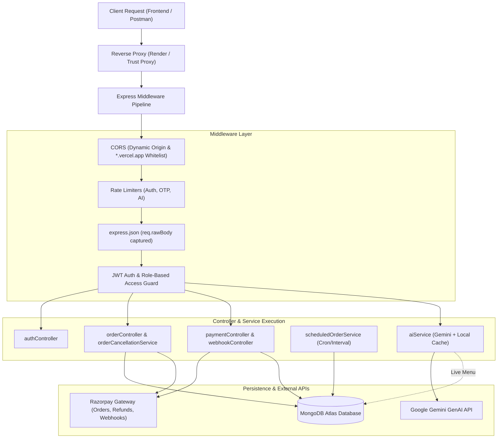

# <div align="center">🍽️ LUX RESTAURANT BACKEND</div>

<div align="center">

**Enterprise Node.js & Express API for Luxury Dining, Real-Time Orchestration & Financial Reconciliation**

[](https://lux-restaurant-backend.onrender.com)
[](https://luxrestaurant.vercel.app/)
[](https://github.com/Sourav142005/LUX-Restaurant-Frontend)

<br/>

[](https://nodejs.org/)
[](https://expressjs.com/)
[](https://www.mongodb.com/)
[](https://razorpay.com/)
[](https://ai.google.dev/)
[-brightgreen?style=flat-square&logo=node.js&logoColor=white)](tests/)
[](package.json)

</div>

---

## 📖 Executive Overview

**LUX Restaurant Backend** is an enterprise-grade RESTful API built on **Node.js, Express 5, and MongoDB (Mongoose 8)**. It drives the end-to-end operational and financial workflows for the **LUX Restaurant Platform**, powering table reservations, multi-channel food ordering, physical floor plans, autonomous kitchen scheduling, conversational artificial intelligence, and payment handling.

The API features an implementation of **Phase 2A Payment & Refund Hardening**, ensuring raw-body HMAC webhook signature verification, event deduplication, full and partial refund audit logging, out-of-order event resilience, and transaction safety during order cancellations.

---

## 📑 Table of Contents

- [Executive Overview](#-executive-overview)
- [System Architecture & Flow](#-system-architecture--flow)
- [Core Functional Capabilities](#-core-functional-capabilities)
  - [Authentication & Identity](#1-authentication--identity)
  - [Order Lifecycle & Payment Policies](#2-order-lifecycle--payment-policies)
  - [Phase 2A Razorpay Hardening & Refunds](#3-phase-2a-razorpay-hardening--refunds)
  - [Floor Management & Reservation Engine](#4-floor-management--reservation-engine)
  - [Autonomous Background Scheduler](#5-autonomous-background-scheduler)
  - [LUX AI Dining Concierge](#6-lux-ai-dining-concierge)
- [Directory Structure](#-directory-structure)
- [Getting Started & Local Setup](#-getting-started--local-setup)
  - [Prerequisites](#prerequisites)
  - [Installation](#installation)
  - [Environment Configuration](#environment-configuration)
  - [Available Scripts](#available-scripts)
- [API Reference Guide](#-api-reference-guide)
  - [Authentication Routes](#authentication-routes-apiauth)
  - [Menu & Category Routes](#menu--category-routes)
  - [Order Management Routes](#order-management-routes-apiorder)
  - [Payment & Webhook Routes](#payment--webhook-routes-apipayment)
  - [Floor & Reservation Routes](#floor--reservation-routes)
  - [Admin & Analytics Routes](#admin--analytics-routes-apiadmin)
  - [LUX AI Concierge Routes](#lux-ai-concierge-routes-apiai)
- [Automated Testing Suite](#-automated-testing-suite)
- [Deployment Guide (Render)](#-deployment-guide-render)
- [Security & Operational Best Practices](#-security--operational-best-practices)
- [Cross-Repository Ecosystem](#-cross-repository-ecosystem)
- [Author & Acknowledgments](#-author--acknowledgments)

---

## 🏛️ System Architecture & Flow



---

## ✨ Core Functional Capabilities

### 1. Authentication & Identity
- **Dual Verification Paths:** Supports standard email/password authentication alongside SMS/Phone OTP verification for mobile-first hospitality workflows.
- **Stateless JWT Tokens:** Encrypted JSON Web Tokens signed with secret-key expiration (24h) and role claims (`customer`, `admin`).
- **Granular Rate Limiting:** Brute-force protection applied specifically to login, registration, and OTP dispatch points via `express-rate-limit`.
- **Password Recovery:** Signed time-limited tokens for web reset alongside numeric OTP codes for mobile verification.

### 2. Order Lifecycle & Payment Policies
- **Dining Modes:** `Dine-In`, `Takeaway`, and `Delivery`.
- **Payment Policies:**
  - `PayNow`: Required for Takeaway and Delivery orders; optional for Dine-In. Requires instant gateway capture before kitchen dispatch.
  - `PayAfterDining`: Exclusively allowed for verified Dine-In guests with an active table or seated reservation.
- **Lifecycle Progression:** Deterministic state machine enforcing valid transitions:<br/>
  `Scheduled` ➔ `Pending` ➔ `Preparing` ➔ `Ready` ➔ `Delivered` / `Cancelled`.
- **Dedicated Cancellation Route:** Generic `PUT /api/order/:id` strictly rejects transitioning to `Cancelled` with HTTP 400, forcing requests through `PATCH /api/order/:id/cancel` to guarantee financial and table-release reconciliation.

### 3. Phase 2A Razorpay Hardening & Refunds
- **Raw-Body HMAC Verification:** Captures untampered byte buffers via `express.json({ verify })` (`req.rawBody`) to calculate cryptographic SHA-256 signatures against `RAZORPAY_WEBHOOK_SECRET`.
- **Event Deduplication:** Maintains a durable `processedWebhookEvents` ledger per order to safely drop duplicate or retransmitted gateway events.
- **Full & Partial Refund Audit Ledger:** Orders maintain an atomic array of refunds:
  ```json
  "refunds": [
    {
      "refundId": "rfnd_XXXXXXXXXXXX",
      "amount": 149.00,
      "status": "processed",
      "createdAt": "2026-10-18T13:08:02.973Z"
    }
  ]
  ```
- **Monotonic Accounting:** Cumulative `amountRefunded` tracks refund totals accurately, recalculating remaining refundable balances (`totalPrice - amountRefunded`) on every cancellation request.
- **Unpaid Cancellation Bypass:** For orders with `paymentStatus: "Pending"`, the cancellation service modifies status to `Cancelled` and safely bypasses all gateway refund API calls (`refunded: false`, `refundId: null`).
- **Durable Reconciliation Flag:** When network timeouts occur during gateway calls, orders are tagged with `reconciliationRequired: true` to flag them for administrative review without corrupting balances.

### 4. Floor Management & Reservation Engine
- **Floor Plan Orchestration:** Tracks table inventory (`capacity`, `tableType`, `status: Available | Occupied | Reserved`).
- **Walk-In QR Integration:** Table-specific QR links allow customers to claim a table immediately upon seated ordering.
- **Reservation Conflict Detection:** Evaluates temporal overlap against target capacity to prevent double bookings.
- **Safe Floor Release:** Walk-in tables are automatically released back to `Available` upon order cancellation or explicit administrative closing (`POST /api/order/:id/close-table`). Seated reservation tables remain locked to protect dining schedules.

### 5. Autonomous Background Scheduler
- Continuous daemon (`services/scheduler.js`) executing every 60 seconds:
  1. **Scheduled Order Activation:** Scans for reservation orders due within 30 minutes (calculated in Indian Standard Time `Asia/Kolkata`), verifies payment or `PayAfterDining` policies, transitions order status to `Pending` for kitchen prep, and occupies the reserved table.
  2. **Expired Reservation Sweep:** Automatically completes past dining sessions and clears occupied table states.
  3. **Concurrency Locks & State Rollback:** Implements simulated atomic check-and-set guards to prevent duplicate processing by concurrent worker instances.

### 6. LUX AI Dining Concierge
- **Astra Conversational Intelligence (`/api/ai/chat`):** Integrated with Google Gemini (`@google/genai`) to provide natural language dish recommendations, wine pairings, ingredient advisories, and price checks.
- **Dynamic In-Memory Caching:** Automatically synchronizes and caches live menu data (60-second TTL) to ensure the AI never recommends 86'd (unavailable) menu items.
- **Deterministic Rule Fallback:** Resilient rule engine kicks in automatically if external API quotas are exhausted or offline, guaranteeing zero customer-facing errors.
- **Structured Cart Action:** Directly emits structured JSON payloads (`itemsToCart`) to populate the user's client-side cart.

---

## 📂 Directory Structure

```text
backend/
├── config/
│   └── db.js                       # Mongoose connection with Windows DNS fallback
├── controllers/
│   ├── adminController.js          # Operations metrics, net revenue, liabilities
│   ├── authController.js           # Registration, login, OTP dispatch, passwords
│   ├── categoryController.js       # Menu category classification
│   ├── menuController.js           # Dish catalog CRUD, pricing, availability
│   ├── orderController.js          # Order lifecycle, payments, safe cancellation
│   ├── paymentController.js        # Razorpay order generation & manual verification
│   ├── reservationController.js    # Table reservation booking & expiry sweeps
│   ├── tableController.js          # Physical floor plan inventory & QR generation
│   ├── userController.js           # User directory & role audits
│   └── webhookController.js        # Raw-body Razorpay webhook event processing
├── middleware/
│   ├── admin.js                    # Role-based administrative authorization guard
│   ├── auth.js                     # JWT verification & req.user identity population
│   └── rateLimiter.js              # Rate-limiting policies for auth, OTP & AI
├── models/
│   ├── Category.js                 # Category schema definition
│   ├── Menu.js                     # Menu dish schema, 3D model links, spice rating
│   ├── Order.js                    # Order schema with Phase 2A refund ledger
│   ├── Payment.js                  # Payment audit record schema
│   ├── Reservation.js              # Booking records, party size, time slots
│   ├── Table.js                    # Floor layout, capacity, status tracking
│   └── User.js                     # User profile, password hashes, OTP states
├── routes/
│   ├── adminRoutes.js              # /api/admin endpoints
│   ├── aiRoutes.js                 # /api/ai endpoints
│   ├── authRoutes.js               # /api/auth endpoints
│   ├── categoryRoutes.js           # /api/category endpoints
│   ├── menuRoutes.js               # /api/menu endpoints
│   ├── orderRoutes.js              # /api/order endpoints
│   ├── paymentRoutes.js            # /api/payment endpoints
│   ├── reservationRoutes.js        # /api/reservation endpoints
│   ├── tableRoutes.js              # /api/table endpoints
│   └── userRoutes.js               # /api/user endpoints
├── services/
│   ├── aiService.js                # Gemini integration, caching & rule fallback
│   ├── orderCancellationService.js # Phase 2A safe refund & reconciliation logic
│   ├── razorpayService.js          # Centralized Razorpay SDK client instance
│   ├── scheduledOrderService.js    # Timed order activation & floor synchronization
│   └── scheduler.js                # 60-second periodic background task daemon
├── tests/
│   ├── orderPaymentPolicy.test.js  # Policy validation & cancellation guard tests
│   ├── scheduledOrderService.test.js # Timed activation, timezone & rollback tests
│   └── webhook.test.js             # Webhook signature, deduplication & refund tests
├── package.json                    # Project dependencies & test scripts
├── server.js                       # Express app bootstrap, CORS, proxy trust & routes
└── README.md                       # Comprehensive backend documentation
```

---

## 🚀 Getting Started & Local Setup

### Prerequisites

- **Node.js:** `v18.0.0` or higher (`v20.x` or `v22.x` recommended)
- **MongoDB:** Local MongoDB instance or free cloud cluster on [MongoDB Atlas](https://www.mongodb.com/atlas)
- **Razorpay Account:** Test Mode credentials from the [Razorpay Dashboard](https://dashboard.razorpay.com/)
- **Google AI Studio Key:** (Optional) API key for Gemini assistant features from [Google AI Studio](https://aistudio.google.com/)

### Installation

1. **Clone the repository:**
   ```bash
   git clone https://github.com/Sourav142005/LUX-Restaurant-Backend.git
   cd LUX-Restaurant-Backend
   ```

2. **Install dependencies:**
   ```bash
   npm install
   ```

### Environment Configuration

Create a `.env` file in the `backend` root. Fill in the placeholders with your test credentials:

```dotenv
# ======================================================
# Server Environment
# ======================================================
PORT=5000
NODE_ENV=development

# ======================================================
# Database
# ======================================================
MONGO_URI=mongodb+srv://<username>:<password>@<cluster>.mongodb.net/lux_restaurant?retryWrites=true&w=majority

# ======================================================
# Authentication
# ======================================================
JWT_SECRET=your_super_secret_jwt_signing_key_min_32_chars

# ======================================================
# CORS Configuration (Comma-separated allowed origins)
# ======================================================
CLIENT_URL=http://localhost:5173,http://localhost:5174,https://luxrestaurant.vercel.app

# ======================================================
# Razorpay Test Mode Credentials
# ======================================================
RAZORPAY_KEY_ID=rzp_test_your_test_key_id
RAZORPAY_KEY_SECRET=your_razorpay_key_secret
RAZORPAY_WEBHOOK_SECRET=your_razorpay_webhook_secret

# ======================================================
# Artificial Intelligence (LUX AI Concierge)
# ======================================================
GEMINI_API_KEY=your_gemini_api_key

# ======================================================
# OTP & Delivery Configuration
# ======================================================
OTP_DELIVERY=console
```

> [!CAUTION]
> Never commit `.env` or production credentials to source control. The `.gitignore` file is pre-configured to exclude all environment and secret files.

### Available Scripts

| Command | Purpose |
| :--- | :--- |
| `npm run dev` | Starts the server in development mode using `nodemon` with automatic reload |
| `npm start` | Launches the production Express server (`node server.js`) |
| `npm test` | Runs the automated Node.js test suite across all 10 test suites (`node --test tests/*.test.js`) |

---

## 📡 API Reference Guide

All API endpoints are prefixed with `/api`.

### Authentication Routes (`/api/auth`)

| Method | Path | Access | Description |
| :--- | :--- | :--- | :--- |
| `POST` | `/api/auth/register` | Public | Register new customer account (name, email, phone, password) |
| `POST` | `/api/auth/login` | Public | Authenticate via email or phone number with password |
| `POST` | `/api/auth/verify-phone` | Public | Verify 6-digit registration OTP |
| `POST` | `/api/auth/resend-phone-otp` | Public | Request a fresh phone verification OTP |
| `POST` | `/api/auth/forgot-password` | Public | Send password reset token to registered email |
| `POST` | `/api/auth/forgot-password-phone`| Public | Dispatch password reset OTP to registered phone |
| `POST` | `/api/auth/reset-password/:token`| Public | Reset password using email verification token |
| `POST` | `/api/auth/reset-password-phone` | Public | Reset password using phone OTP |
| `GET` | `/api/auth/profile` | Authenticated | Retrieve authenticated user profile |
| `GET` | `/api/auth/admin-test` | Admin | Validate administrative authorization guard |

### Menu & Category Routes

| Method | Path | Access | Description |
| :--- | :--- | :--- | :--- |
| `GET` | `/api/menu` | Public | Retrieve active menu catalog with category population |
| `GET` | `/api/menu/:id` | Public | Retrieve detailed menu item by MongoDB ObjectId |
| `POST` | `/api/menu` | Admin | Create a new menu item |
| `PUT` | `/api/menu/:id` | Admin | Update dish details, price, availability, or 3D model link |
| `DELETE` | `/api/menu/:id` | Admin | Delete dish from menu catalog |
| `GET` | `/api/category` | Public | List all culinary categories |
| `POST` | `/api/category` | Admin | Create a new category |
| `PUT` | `/api/category/:id` | Admin | Update category name or description |
| `DELETE` | `/api/category/:id` | Admin | Delete category |

### Order Management Routes (`/api/order`)

| Method | Path | Access | Description |
| :--- | :--- | :--- | :--- |
| `POST` | `/api/order` | Authenticated | Create a new order (validates payment policy, table & items) |
| `GET` | `/api/order/my` | Authenticated | Retrieve logged-in customer's order history |
| `GET` | `/api/order/:id` | Authenticated | Retrieve single order details |
| `PATCH` | `/api/order/:id/cancel` | Authenticated / Admin | **Safe Cancellation:** Unpaid orders bypass refund; paid orders execute remaining balance refund |
| `POST` | `/api/order/:orderId/payment` | Authenticated | Generate a Razorpay order in paise for online settlement |
| `POST` | `/api/order/:orderId/payment/verify` | Authenticated | Client-side HMAC signature verification |
| `POST` | `/api/order/:id/close-table` | Authenticated | Close table session and release floor availability |
| `GET` | `/api/order` | Admin | Query all orders (supports `reconciliationRequired=true` filter) |
| `PUT` | `/api/order/:id` | Admin | Update kitchen order status (`Pending` ➔ `Preparing` ➔ `Ready` ➔ `Delivered`) |
| `DELETE`| `/api/order/:id` | Admin | Delete order record |
| `POST` | `/api/order/process-scheduled` | Admin | Manually trigger scheduled order processor |

### Payment & Webhook Routes (`/api/payment`)

| Method | Path | Access | Description |
| :--- | :--- | :--- | :--- |
| `POST` | `/api/payment/webhook` | Webhook (HMAC) | **Razorpay Webhook Handler:** Raw-body verified event listener (`payment.captured`, `order.paid`, `payment.failed`, `refund.processed`, `refund.failed`) |
| `POST` | `/api/payment/create` | Authenticated | Alternate entry point for Razorpay order initialization |
| `POST` | `/api/payment/verify` | Authenticated | Alternate entry point for client payment verification |

### Floor & Reservation Routes

| Method | Path | Access | Description |
| :--- | :--- | :--- | :--- |
| `GET` | `/api/table` | Authenticated | Retrieve complete floor plan inventory |
| `POST` | `/api/table` | Admin | Create new physical table (number, capacity, location) |
| `PUT` | `/api/table/:id/status` | Admin | Modify table status (`Available`, `Occupied`, `Reserved`) |
| `DELETE`| `/api/table/:id` | Admin | Remove table from inventory |
| `GET` | `/api/reservation/available` | Authenticated | Query available tables for specified date, time, and guest count |
| `POST` | `/api/reservation` | Authenticated | Book a table reservation |
| `GET` | `/api/reservation/my` | Authenticated | Retrieve authenticated user's reservations |
| `PATCH` | `/api/reservation/:id/cancel`| Authenticated | Cancel personal table reservation |
| `GET` | `/api/reservation` | Admin | Query all restaurant reservations |
| `PUT` | `/api/reservation/:id/status`| Admin | Update reservation status (`Confirmed`, `Cancelled`, `Completed`) |

### Admin & Analytics Routes (`/api/admin`)

| Method | Path | Access | Description |
| :--- | :--- | :--- | :--- |
| `GET` | `/api/admin/dashboard` | Admin | Comprehensive KPI aggregation: Net Revenue (gross minus processed refunds), active orders, customer counts, pending liabilities |
| `GET` | `/api/admin/orders` | Admin | Administrative order inspection pipeline |
| `GET` | `/api/user` | Admin | Directory of registered customer accounts and roles |

### LUX AI Concierge Routes (`/api/ai`)

| Method | Path | Access | Description |
| :--- | :--- | :--- | :--- |
| `POST` | `/api/ai/chat` | Public (Rate-Limited)| Conversational food recommendation assistant. Accepts `{ message, context }` and returns `{ reply, action, itemsToCart }` |

---

## 🧪 Automated Testing Suite

The backend contains a suite of automated unit and integration tests executing natively via the Node.js test runner (`node:test`).

```bash
npm test
```

### Verified Test Results

```text
▶ Order Controller - Payment Policy Validation Tests (3 tests)
▶ Order Controller - Cancellation Safeguard & Reason Handling Tests (3 tests)
▶ Scheduled Order Service - Phase 1 Integration Tests (16 tests)
▶ Razorpay Webhook - Phase 2A Core Hardening Tests (12 tests)
▶ Razorpay Webhook - Deduplication & Concurrency (9 tests)
▶ Razorpay Webhook - Phase 2A Final Hardening Tests (9 tests)
▶ Razorpay Webhook - Refund Lifecycle & Reconciliation Hardening (7 tests)
▶ Razorpay Payment Hardening - Phase 2A Final Implementation Tests (9 tests)
▶ Razorpay Refund Recovery & Concurrency Hardening (13 tests)
▶ Edge Cases & Out-of-Order Webhook Resolution (5 tests)

ℹ tests 87
ℹ suites 10
ℹ pass 87
ℹ fail 0
ℹ duration_ms ~640ms
```

---

## ☁️ Deployment Guide (Render)

The backend is configured for deployment as a **Web Service** on [Render](https://render.com).

1. **Create Web Service:** Link the GitHub repository `Sourav142005/LUX-Restaurant-Backend`.
2. **Runtime Environment:** Select **Node**.
3. **Build & Start Commands:**
   - **Build Command:** `npm install`
   - **Start Command:** `npm start`
4. **Environment Variables:** Set all required variables documented in the [Environment Configuration](#environment-configuration) section.
5. **Proxy Configuration:** The server includes `app.set("trust proxy", 1)` to handle SSL termination and accurate client IP resolution behind Render's reverse proxy.
6. **Razorpay Webhook Registration:**
   - In your Razorpay Dashboard ➔ Settings ➔ Webhooks:
   - **URL:** `https://lux-restaurant-backend.onrender.com/api/payment/webhook`
   - **Secret:** Must match your `RAZORPAY_WEBHOOK_SECRET` environment variable.
   - **Events:** `payment.captured`, `order.paid`, `payment.failed`, `refund.processed`, `refund.failed`.

Live API Base URL: **[https://lux-restaurant-backend.onrender.com](https://lux-restaurant-backend.onrender.com)**

---

## 🔒 Security & Operational Best Practices

- **Zero-Secret Commits:** Configuration is read strictly from `process.env`. No credentials or fallback passwords exist in application controllers.
- **Cryptographic Signature Verification:** Webhooks use constant-time byte comparisons (`crypto.timingSafeEqual`) on raw body payloads to thwart timing attacks.
- **Strict Role-Based Isolation:** Non-admin callers attempting to access `/api/admin/*` or modify other users' orders are rejected with HTTP 403 Forbidden.
- **CORS Protection:** Rejects unauthorized origin headers while dynamically permitting localhost dev environments and production Vercel frontends.

---

## 🌐 Cross-Repository Ecosystem

| Component | Repository Link | Deployed URL |
| :--- | :--- | :--- |
| **Backend REST API** | [Sourav142005/LUX-Restaurant-Backend](https://github.com/Sourav142005/LUX-Restaurant-Backend) | [lux-restaurant-backend.onrender.com](https://lux-restaurant-backend.onrender.com) |
| **Frontend Web App** | [Sourav142005/LUX-Restaurant-Frontend](https://github.com/Sourav142005/LUX-Restaurant-Frontend) | [luxrestaurant.vercel.app](https://luxrestaurant.vercel.app/) |

---

## 👨‍💻 Author & Acknowledgments

**Sourav Shridhar Kamble**<br/>
- **GitHub:** [@Sourav142005](https://github.com/Sourav142005)
- **LinkedIn:** [Sourav Kamble](https://www.linkedin.com/in/sourav-kamble)
- **Email:** [sourav142005@gmail.com](mailto:sourav142005@gmail.com)

---

<div align="center">
<sub>Engineered for reliability, financial accuracy, and luxury dining operations. &copy; 2026 LUX Restaurant Platform.</sub>
</div>
